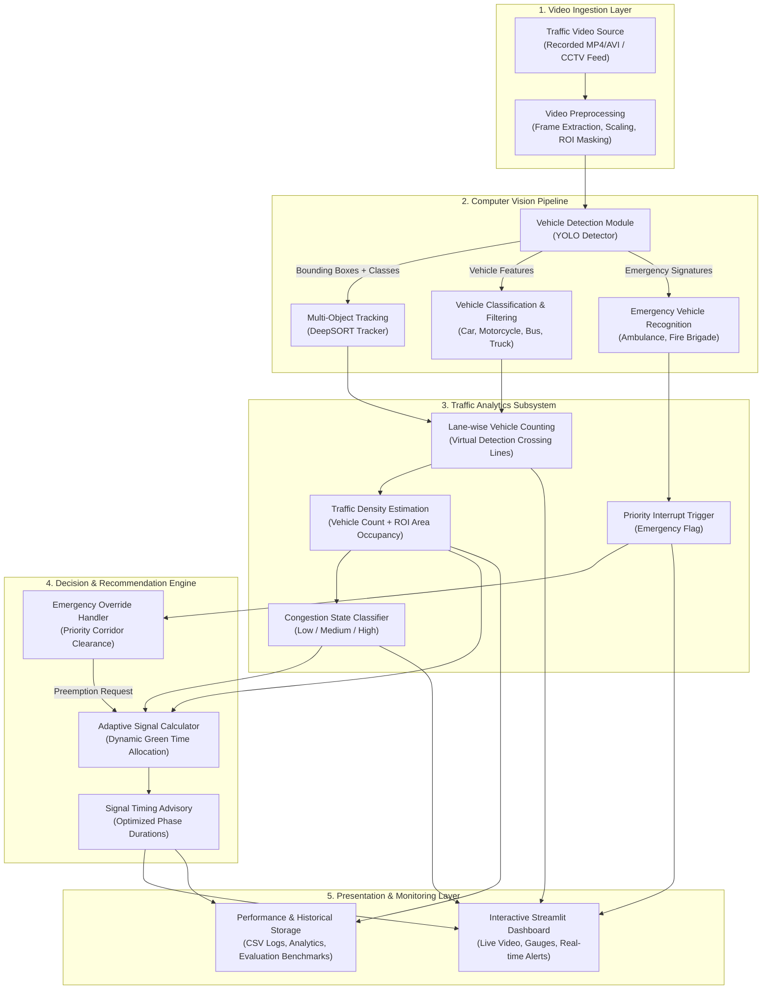

# Intelligent Traffic Management System Using Computer Vision

[](https://www.python.org/)
[](https://opencv.org/)
[](https://streamlit.io/)
[](LICENSE)
[](docs/project-overview.md)
[](docs/evaluation-progress.md)

An end-to-end computer-vision-based intelligent traffic management software prototype that transforms recorded intersection video feeds into real-time traffic density analytics, congestion classifications, emergency vehicle alerts, and adaptive traffic signal recommendations.

---

## 🎓 Academic Details

- **Project Title:** Intelligent Traffic Management System Using Computer Vision
- **Academic Session:** 2026–2027
- **Degree Program:** Bachelor of Technology (B.Tech)
- **Specialization:** Computer Science and Engineering (Artificial Intelligence & Machine Learning)
- **Institution:** School of Computer Science and Engineering, IILM University, Greater Noida
- **Project Supervisor:** **Dr. Lalit Mohan Gupta**, Assistant Professor
- **Project Team:**
  - **Supriya** (Roll No: 2410031272)
  - **Md Saddam Hussain** (Roll No: 2410030828)
  - **Keshav Kulshresth** (Roll No: 2410030067)
  - **Aditya Kumar Saxena** (Roll No: 2410030599)
- **Project Type:** Software-only prototype evaluated on recorded traffic videos (no physical traffic light hardware).
- **Target Evaluations:** Mid-Term Evaluation & Phase III Implementation Evaluation.

---

## 📌 Problem Statement

Traditional traffic control systems rely on rigid pre-programmed timing splits (e.g., fixed 30-second cycles) that do not account for dynamic directional congestion. As a consequence, vehicles waste time idling at red lights facing empty lanes, while congested approaches suffer extensive queue spillbacks. In-road physical sensors (inductive loops) are expensive and vulnerable to road wear, while manual camera monitoring is prone to human operator fatigue.

This project delivers a **purely software-based prototype** that analyzes recorded traffic video, estimates lane-wise vehicle density, recognizes high-priority emergency vehicles (ambulances, fire engines), and computes dynamic, proportional green light durations to optimize intersection clearance.

---

## 🎯 Objectives

### Primary Objective
To design, implement, and evaluate an integrated computer vision and decision software prototype that analyzes traffic video in real time to recommend adaptive traffic signal timings.

### Specific Objectives
1. **Vehicle Detection:** Localize and classify road vehicles (cars, motorcycles, buses, trucks) using the YOLO architecture.
2. **Vehicle Tracking:** Maintain unique trajectory identities across consecutive video frames using DeepSORT.
3. **Directional Counting:** Tally cumulative vehicle crossings per approach lane using virtual tripwires.
4. **Spatial Density Estimation:** Compute composite lane occupancy combining vehicle counts and bounding-box area ratios.
5. **Congestion Classification:** Categorize real-time traffic flow into discrete states: *LOW*, *MEDIUM*, and *HIGH*.
6. **Emergency Priority Preemption:** Flag emergency vehicles and trigger priority corridor clearance.
7. **Adaptive Signal Advisory:** Dynamically allocate green times proportional to traffic demand within safe legal bounds ($15\text{s} \le G \le 90\text{s}$).
8. **Interactive Web Dashboard:** Present video telemetry, congestion gauges, emergency notifications, and signal recommendations via Streamlit.

---

## 🌟 Feature Status: Implemented vs. Proposed

To preserve academic integrity, the repository explicitly distinguishes between verified baseline implementations and Phase III integration targets:

| Feature / Subsystem | Stage | Status in Repo | Details |
| :--- | :---: | :---: | :--- |
| **Video Ingestion & Metadata Inspector** | Mid-Term | **Implemented & Verified** | OpenCV stream extraction (Resolution, FPS, Frame Count, Duration) |
| **Adaptive Signal Recommendation Engine** | Mid-Term | **Implemented & Verified** | Proportional green allocation bounded by 15s–90s |
| **Spatial Density & Congestion Classifier** | Mid-Term | **Implemented & Verified** | Count + area occupancy model with Low/Med/High states |
| **Interactive Streamlit Web Dashboard** | Mid-Term | **Implemented & Verified** | Video inspection preview + dynamic timing simulator |
| **Emergency Priority Override Logic** | Mid-Term | **Implemented & Verified** | Dedicated preemption handler and clearance timing rules |
| **Automated Unit & Invariant Smoke Tests**| Mid-Term | **Implemented & Verified** | Unittest suite verifying configuration and algorithm bounds |
| **Modular YOLO Detection Wrapper** | Phase III | **In-Progress** | Clean interface created; awaiting weights placement (`yolov8n.pt`) |
| **Modular DeepSORT Tracking Wrapper** | Phase III | **In-Progress** | State estimation framework ready for appearance model integration |
| **Live Bounding-Box Video Stream Overlay** | Phase III | **Planned** | Real-time inference on full-length traffic video |
| **Hardware Throughput Benchmarks (FPS)** | Phase III | **Planned** | Empirical profiling on target CPU and GPU devices |

---

## 🛠️ Technology Stack

- **Programming Language:** Python 3.10 – 3.13
- **Computer Vision & Video Processing:** OpenCV (`opencv-python`), NumPy, Pillow
- **Object Detection & Tracking:** YOLO (Ultralytics), DeepSORT (`deep-sort-realtime`)
- **Data Processing & Analytics:** Pandas, SciPy
- **Data Visualization & Dashboard:** Streamlit, Matplotlib
- **Configuration & Testing:** PyYAML, Python `unittest` / `pytest`

---

## 🏛️ System Architecture



---

## ⚡ 5-Minute Quickstart & Setup Guide

### 1. Prerequisites
- **Operating System:** Windows, macOS, or Linux
- **Python Version:** Python 3.10 to 3.13 installed
- **Git:** Git CLI installed

### 2. Clone and Setup Environment
```bash
# Clone the repository
git clone https://github.com/<your-username>/intelligent-traffic-management.git
cd intelligent-traffic-management

# Create and activate a virtual environment
python -m venv .venv

# On Windows:
.venv\Scripts\activate
# On Linux / macOS:
# source .venv/bin/activate

# Install core dependencies (takes < 2 minutes)
pip install -r requirements.txt
```

### 3. Verify the Installation
Run the built-in diagnostic checker:
```bash
python src/main.py --check-env
```

### 4. Run the Automated Test Suite
```bash
python -m unittest discover -s tests
```
*(All smoke tests validate configuration, density formulas, and timing bounds out-of-the-box).*

### 5. Launch the Streamlit Web Dashboard
```bash
streamlit run src/dashboard/app.py
```
Open your browser at `http://localhost:8501`. You can immediately:
- Upload any recorded traffic video (or select local sample video);
- Inspect resolution, frame rate, duration, and codec telemetry;
- Interact with the real-time **Adaptive Signal Timing Simulator**.

---

## 🧠 Model Weights Setup (For Phase III)

The repository stays lightweight by excluding heavy binary model checkpoints from Git. To enable full deep learning object detection in Phase III:

1. Download the lightweight YOLOv8 nano model:
   ```bash
   python -c "from ultralytics import YOLO; YOLO('yolov8n.pt')"
   ```
2. Move the downloaded `yolov8n.pt` file into the designated weights folder:
   ```bash
   # Windows PowerShell:
   Move-Item yolov8n.pt models/weights/
   ```
3. The system automatically detects the weights on subsequent runs. If weights are missing, the system gracefully operates in diagnostic mode without crashing.

---

## 📂 Repository Directory Tree

```
intelligent-traffic-management/
├── README.md                          # Main project documentation & quickstart
├── requirements.txt                   # Core & optional dependencies
├── .gitignore                         # Comprehensive Python/Media/Weights ignore rules
├── LICENSE                            # MIT License with student & university copyright
├── docs/                              # Formal Academic Documentation
│   ├── project-overview.md            # Academic context, objectives, scope boundaries
│   ├── literature-review.md           # 20 peer-reviewed papers survey with DOIs & gaps
│   ├── system-architecture.md         # Subsystem breakdown & pipeline details
│   ├── methodology.md                 # Algorithmic & mathematical formulations
│   ├── implementation-plan.md         # 8-milestone roadmap & Work Breakdown Structure
│   ├── testing-plan.md                # Evaluation metrics (mAP, MOTA, MAE, FPS)
│   ├── evaluation-progress.md         # 4-tier status matrix & evidence checklists
│   └── references.md                  # Verifiable IEEE bibliography with DOIs
├── architecture/
│   └── system-architecture.mmd        # GitHub-renderable Mermaid flowchart
├── src/                               # Modular Source Code
│   ├── __init__.py
│   ├── config.py                      # Central paths, timing limits, and class settings
│   ├── main.py                        # Unified CLI runner (diagnostics, video, simulation)
│   ├── detection/                     # Vehicle Detection Subsystem
│   │   ├── README.md
│   │   └── detector.py                # Modular YOLO wrapper with graceful fallbacks
│   ├── tracking/                      # Multi-Object Tracking Subsystem
│   │   ├── README.md
│   │   └── tracker.py                 # DeepSORT wrapper & track management
│   ├── traffic_analysis/              # Analytics & Decision Subsystem
│   │   ├── README.md
│   │   ├── density.py                 # Composite spatial density & congestion classifier
│   │   └── signal_advisor.py          # Proportional demand adaptive signal calculator
│   ├── emergency_detection/           # Emergency Preemption Subsystem
│   │   ├── README.md
│   │   └── emergency.py               # Emergency vehicle detection & override logic
│   └── dashboard/                     # Web Presentation Subsystem
│       ├── README.md
│       └── app.py                     # Interactive Streamlit dashboard
├── tests/                             # Automated Test Suite
│   ├── README.md
│   └── test_smoke.py                  # Unit tests for configs, bounds, & invariants
├── data/                              # Traffic Videos & Datasets
│   ├── README.md                      # Guide to UA-DETRAC, BDD100K & local footage
│   ├── raw/                           # Raw traffic video clips (.gitkeep)
│   ├── sample/                        # Small testing clips (.gitkeep)
│   └── processed/                     # Preprocessed evaluation outputs (.gitkeep)
├── results/                           # Empirical Results & Benchmarking
│   ├── README.md
│   └── benchmark_template.csv         # Schema for Phase III performance logging
└── assets/                            # Media & Documentation Assets
    └── README.md
```

---

## 🚫 Limitations & Non-Goals

- **Software Prototype Only:** This project is an analytical software prototype. It does not fabricate or rewire physical traffic signal lights or electronic microcontrollers.
- **Advisory Output:** Recommendations are rendered to a central dashboard for traffic management operators; no direct actuation of live municipal signals is attempted.
- **No Roadside Camera Deployment:** The system is evaluated on recorded traffic footage.
- **No Law Enforcement / ANPR:** The project does not capture license plates or issue automated traffic fines.

---

## 🗺️ Project Roadmap & Evaluation Milestones

```
+---------------------------------------------------------------------------------+
| Phase I (Completed)  : Problem Formulation, Feasibility, 20-Paper Survey       |
| Mid-Term (Current)   : Repository Architecture, Ingestion, Baseline Dashboard  |
| Phase III (Upcoming) : Vision Inference (YOLO), Tracking (DeepSORT), Benchmarks |
+---------------------------------------------------------------------------------+
```
See [`docs/evaluation-progress.md`](docs/evaluation-progress.md) for the complete academic evidence checklists.

---

## 📜 Citation & Academic Use

If utilizing this codebase or documentation for academic evaluation or research:

```bibtex
@misc{iilm_traffic_2026,
  author = {Supriya and Md Saddam Hussain and Keshav Kulshresth and Aditya Kumar Saxena},
  title = {Intelligent Traffic Management System Using Computer Vision},
  year = {2026},
  howpublished = {Major Project, School of Computer Science and Engineering, IILM University, Greater Noida},
  note = {Supervised by Dr. Lalit Mohan Gupta}
}
```
