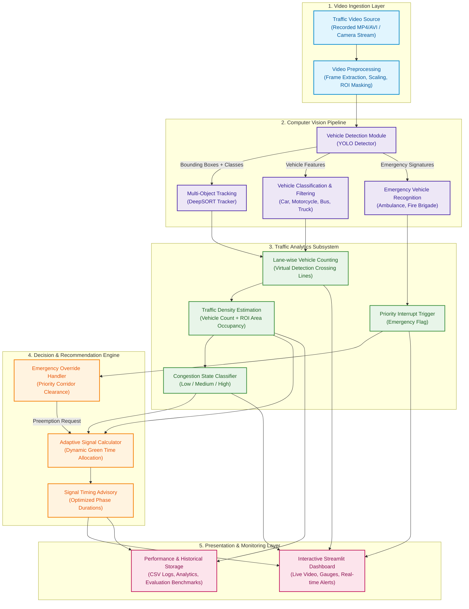

# System Architecture

## 1. Architectural Philosophy

The **Intelligent Traffic Management System** is engineered using a modular, decoupled pipeline architecture. By separating video ingestion, computer vision inference, traffic telemetry analysis, decision logic, and user visualization into distinct subsystems, the system ensures:
- **Maintainability:** Each module can be tested, replaced, or upgraded independently (e.g., swapping YOLOv8 for YOLOv7 without altering the traffic decision engine).
- **Graceful Degradation:** If deep learning weights are missing or GPU acceleration is unavailable, the pipeline signals an explicit diagnostic warning rather than silently crashing or generating falsified predictions.
- **Hardware-Free Prototyping:** The architecture runs entirely in software on recorded traffic videos, eliminating dependencies on physical microcontrollers or municipal signal hardware.

---

## 2. End-to-End System Architecture Diagram

---

## 3. Subsystem Breakdown & Dataflow

### 3.1 Video Ingestion & Preprocessing Subsystem
- **Source Ingestion:** Ingests standard video container formats (`.mp4`, `.avi`, `.mov`) via OpenCV (`cv2.VideoCapture`).
- **Stream Decoding & Frame Normalization:** Extracts RGB frames at native or downsampled frame rates (e.g., skip frames if hardware is CPU-constrained).
- **Region of Interest (ROI) Masking:** Implements polygonal masks corresponding to each intersection lane or approach, eliminating off-road background noise (trees, pedestrian sidewalks, sky).

### 3.2 Vehicle Detection Subsystem (YOLO)
- **Model Backbone:** Single-stage CNN / Vision Transformer architecture (YOLOv8 / YOLOv7).
- **Class Filtering:** Filters detections strictly to road-transport categories:
  - Class 2: `car`
  - Class 3: `motorcycle`
  - Class 5: `bus`
  - Class 7: `truck`
- **Output:** Bounding box coordinates $[x_1, y_1, x_2, y_2]$, confidence score $c \in [0, 1]$, and predicted class ID. Non-Maximum Suppression (NMS) removes redundant overlapping predictions.

### 3.3 Multi-Object Tracking Subsystem (DeepSORT)
- **State Estimation:** A Kalman filter tracks an 8-dimensional state vector representing bounding box center position, aspect ratio, height, and their respective velocities:
  $$\mathbf{x} = [u, v, \gamma, h, \dot{u}, \dot{v}, \dot{\gamma}, \dot{h}]^T$$
- **Data Association:** Bounding boxes from the current frame are matched against existing track predictions using a combined distance metric:
  1. **Mahalanobis Distance:** Rejects spatially improbable associations.
  2. **Cosine Appearance Distance:** Extracted 128-dimensional deep feature embeddings enable track re-identification even after temporary occlusions behind larger vehicles.
- **Output:** Unique persistent tracking identifier (`track_id`) and smoothed trajectory coordinates.

### 3.4 Traffic Analytics Subsystem
- **Virtual Detection Lines:** Defines two-point virtual tripwires across each lane. When a vehicle track centroid vector crosses from entry side to exit side, the directional lane counter increments.
- **Spatial Density Estimation:** Combines discrete vehicle count with cumulative bounding-box area occupancy relative to total lane ROI area:
  $$D_{lane} = w_1 \cdot \left(\frac{N_{lane}}{N_{capacity}}\right) + w_2 \cdot \left(\frac{\sum Area_{bbox}}{Area_{ROI}}\right)$$
- **Congestion Classification:** Evaluates density against defined breakpoints:
  - **LOW Congestion:** $D < 0.35$ (Free-flow traffic)
  - **MEDIUM Congestion:** $0.35 \le D < 0.70$ (Moderate queueing)
  - **HIGH Congestion:** $D \ge 0.70$ (Severe bottleneck/gridlock)

### 3.5 Emergency Vehicle Recognition Subsystem
- **Target Classes:** Specialized classification for emergency vehicles (`ambulance`, `fire_truck`, `police_vehicle`).
- **Priority Event Trigger:** If an emergency vehicle is detected with confidence exceeding threshold ($c \ge 0.65$) within an approaching lane, an asynchronous **Emergency Interrupt Flag** is issued to the Decision Engine.

### 3.6 Traffic Decision Engine (Adaptive Signal Advisory)
- **Dynamic Green Time Allocation:** Instead of fixed 30-second cycles, the engine allocates green time proportionally based on directional demand while enforcing legal safety bounds:
  - Minimum Green Time ($G_{min}$): Default 15 seconds (ensures pedestrian safety and queue start-up clearance).
  - Maximum Green Time ($G_{max}$): Default 90 seconds (prevents starvation on minor approaches).
  - Yellow Transition Time ($Y$): 4 seconds; All-Red Clearance ($R_{all}$): 2 seconds.
- **Emergency Preemption Logic:** When an emergency flag is raised, the designated approach is granted immediate priority clearance, overriding normal cycle rotations until the emergency vehicle exits the intersection zone.

### 3.7 Presentation & Storage Layer
- **Streamlit Interactive Dashboard:** Renders live video feeds with bounding boxes, lane density gauges, congestion warning badges, emergency strobe alerts, and dynamic countdown timers.
- **Metrics Logger:** Records timestamped CSV telemetry (vehicle counts, lane densities, recommended vs baseline signal times) to enable reproducible Phase III evaluations and academic reporting.
